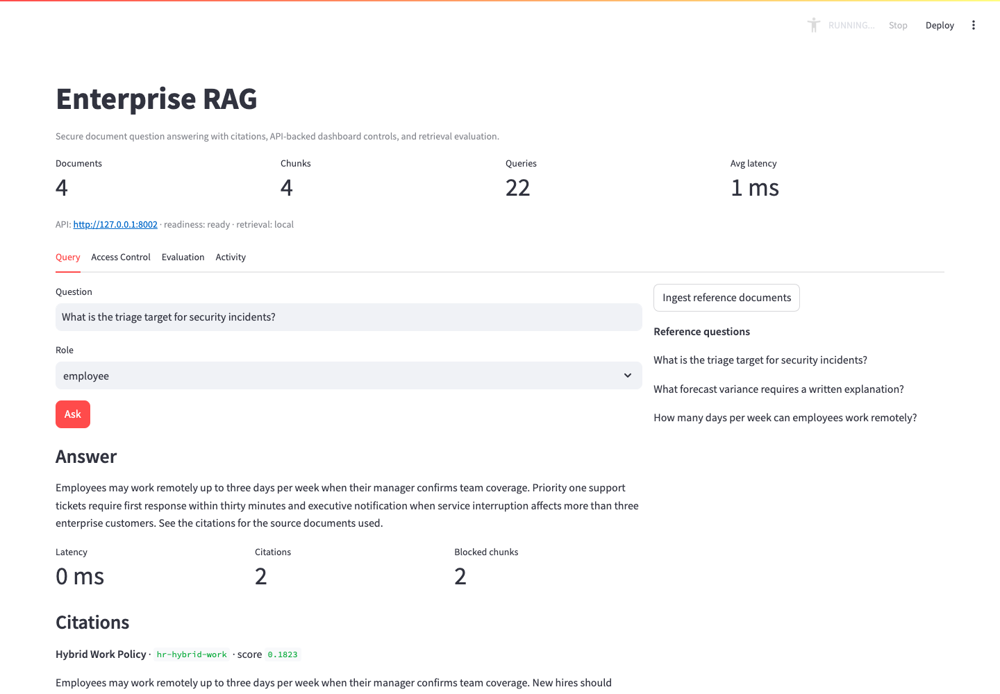
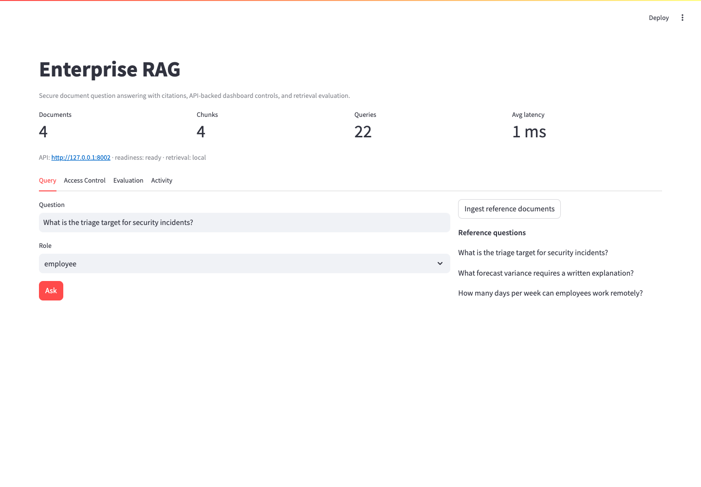
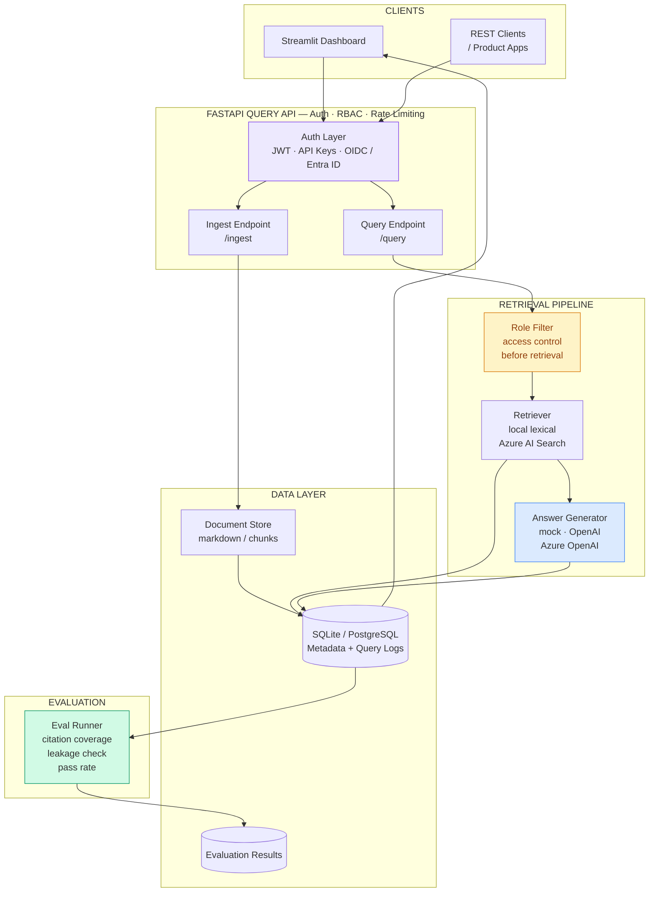
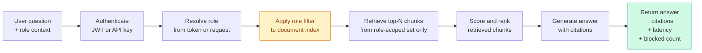

# Enterprise RAG

> Secure knowledge search for internal documents — citation-backed answers, role-based access control, and measurable retrieval quality.


---

## The Problem

Enterprise knowledge is scattered across policy documents, finance reports, security runbooks, HR guides, and operational wikis. Employees waste time searching SharePoint, asking colleagues, or skipping the search entirely. Answers are inconsistent. Sources are untraceable.

The deeper problem is access control. A general-purpose search that returns finance forecasts to an employee, or security incident details to a contractor, creates a compliance and data governance risk. Most RAG implementations ignore this entirely.

This platform answers employee questions from internal documents — with the source cited for every claim — and enforces role-based access at the retrieval layer, before any document is scored or returned.

---

## What It Does

- **Returns citation-backed answers** — every response identifies the source document, chunk, and retrieval score. Answers are traceable to their source; claims cannot be fabricated from documents that were not retrieved
- **Enforces access control before retrieval** — restricted documents are excluded from the candidate set entirely, not filtered from the response after the fact. An employee role cannot retrieve a finance forecast regardless of how the question is phrased
- **Measures retrieval quality** — a built-in evaluation set tests citation coverage, answer pass rate, and restricted document leakage on every run. Quality is a number, not an opinion

---

## Access Control — The Core Differentiator

The same question. Two roles. Two different answers.


*Left: Employee role — finance forecast document is not in scope, access correctly denied. Right: Finance role — restricted document retrieved, answer generated with citation.*

Access control is applied at the retrieval layer. The `employee` role never sees the finance forecast document in its candidate set — not because the response was filtered, but because the document was never retrieved.

---

## Citation-Backed Answers



*Every answer names the source document, chunk ID, and retrieval score. No answer without a citation.*

---

## Retrieval Quality Dashboard



*Document and chunk counts, query volume, average latency, and reference questions — all visible at a glance.*

---

## Measurable Retrieval Quality


*Evaluation set: 4 cases, 4 passed, 0 restricted leaks, citation coverage 1.75. Run on demand or on a schedule.*

---

## System Architecture



---

## Query Pipeline — How RBAC Works



The role filter runs before retrieval. Restricted chunks are not in the candidate pool — they cannot be ranked, scored, or accidentally included in an answer regardless of semantic similarity.

---

## Key Capabilities

| Capability | Detail |
|------------|--------|
| **Role-based retrieval** | Documents tagged with allowed roles — `all`, `employee`, `engineer`, `finance`, `admin`. Role filter applied before candidate selection |
| **Citation tracing** | Every answer returns source document name, chunk ID, and retrieval score. No citation = answer not returned |
| **Multi-provider retrieval** | Local lexical retrieval for offline/demo use; Azure AI Search for production scale |
| **Multi-provider generation** | Mock (deterministic, no API key), OpenAI, Azure OpenAI — switchable via environment variable |
| **API key management** | Per-user API keys with role binding, SHA-256 hashing, and revocation |
| **OIDC / Entra ID** | Production auth via Entra ID bearer tokens with role claim extraction |
| **Evaluation set** | Built-in test suite: citation coverage, answer pass rate, restricted document leakage count |
| **Prometheus metrics** | Operational metrics at `/metrics` — query count, latency, RBAC block rate |
| **Docker Compose** | Containerized topology: API + dashboard + PostgreSQL |
| **Azure-ready** | Azure AI Search, Azure OpenAI, Entra ID, Blob Storage, Container Apps paths documented |

---

## Supported Document Types

| Source | Supported |
|--------|-----------|
| Markdown files | Local and Azure Blob Storage |
| Plain text | Local ingestion |
| Azure AI Search index | Production retrieval at scale |

Document metadata specifies which roles may retrieve each document. Adding a new document type requires one new ingestion adapter.

---

## Quickstart

```bash
# 1. Clone and set up environment
git clone https://github.com/manjunath-hanmantgad/enterprise-rag.git
cd enterprise-rag
python3.12 -m venv .venv && source .venv/bin/activate
pip install -r requirements.txt

# 2. Configure
cp .env.example .env

# 3. Seed demo documents and data
python demo/seed_data.py

# 4. Start the API
uvicorn enterprise_rag.api:app --host 127.0.0.1 --port 8002

# 5. Start the dashboard (separate terminal)
streamlit run dashboard/app.py --server.address 127.0.0.1 --server.port 8511
```

| Service | URL |
|---------|-----|
| API health | http://127.0.0.1:8002/health |
| Dashboard | http://127.0.0.1:8511 |

No LLM API key required — `LLM_PROVIDER=mock` runs fully offline with deterministic responses.

---

## Demo Walkthrough

**Five minutes, four screens:**

1. **Query tab** — ask *"What is the triage target for security incidents?"* as `employee`. Answer returns with citations.
2. **Access Control tab** — ask *"What forecast variance requires a written explanation?"* and compare Employee vs Finance responses side by side. Employee is denied; Finance sees the answer with citation.
3. **Create a Finance API key** — register `fatima.finance` with `finance` role, generate an API key. Re-run the finance question using `X-API-Key`. Finance document is now cited.
4. **Evaluation tab** — run the evaluation set. Shows pass rate, citation coverage, and restricted leakage count.

---

## Configuration

| Variable | Default | Description |
|----------|---------|-------------|
| `LLM_PROVIDER` | `mock` | `mock`, `openai`, or `azure` |
| `RAG_RETRIEVAL_PROVIDER` | `local` | `local` or `azure_ai_search` |
| `STORAGE_BACKEND` | `sqlite` | `sqlite`, `postgres`, or `azure_postgres` |
| `RAG_DATABASE_PATH` | `./rag.db` | SQLite database path |
| `RAG_DOCUMENT_PATH` | `./demo/documents` | Local document directory |
| `AUTH_PROVIDER` | `local` | `local`, `oidc`, or `entra` |
| `ADMIN_TOKEN` | — | Required for ingestion and eval endpoints |
| `OPENAI_API_KEY` | — | Required when `LLM_PROVIDER=openai` |
| `CORS_ORIGINS` | `*` | Allowed browser origins |

Full variable reference including Azure AI Search, Entra ID, and Key Vault options: [`.env.example`](.env.example)

---

## Azure Production Path

| Local | Azure Production |
|-------|-----------------|
| Local lexical retrieval | Azure AI Search (full-text + vector) |
| Mock / OpenAI generation | Azure OpenAI |
| SQLite (`STORAGE_BACKEND=sqlite`) | Azure Database for PostgreSQL |
| Markdown files in `demo/documents` | Azure Blob Storage |
| `uvicorn` local process | Azure Container Apps |
| JWT local keys | Azure Entra ID (`AUTH_PROVIDER=entra`) |
| `.env` file | Azure Key Vault + Managed Identity |
| Print logs | Azure Application Insights |

Full deployment guide: [docs/deployment.md](docs/deployment.md)

---

## Evaluation

The built-in evaluation set tests three things on every run:

| Metric | What It Measures |
|--------|-----------------|
| **Pass rate** | Fraction of test questions answered correctly against reference answers |
| **Citation coverage** | Average number of source documents cited per answer |
| **Restricted leakage** | Count of restricted documents appearing in answers for unauthorized roles — must be zero |

Run evaluation on demand:

```bash
python -c "import httpx; httpx.post('http://127.0.0.1:8002/eval/run', headers={'Authorization': 'Bearer $ADMIN_TOKEN'})"
```

---

## Tech Stack

| Layer | Technology |
|-------|------------|
| Query API | FastAPI + Uvicorn |
| Dashboard | Streamlit |
| Retrieval | Local lexical / Azure AI Search |
| Generation | Deterministic mock / OpenAI / Azure OpenAI |
| Database | SQLAlchemy + SQLite (Postgres-ready) |
| Auth | JWT + API keys + OIDC / Entra ID (python-jose) |
| Metrics | Prometheus-compatible `/metrics` endpoint |
| Testing | pytest |

---

## Further Reading

| Document | Contents |
|----------|---------|
| [docs/architecture.md](docs/architecture.md) | Component detail and Azure-ready diagrams |
| [docs/api.md](docs/api.md) | Full API reference |
| [docs/deployment.md](docs/deployment.md) | Azure deployment steps |
| [demo/README.md](demo/README.md) | Demo walkthrough and validation workflow |
