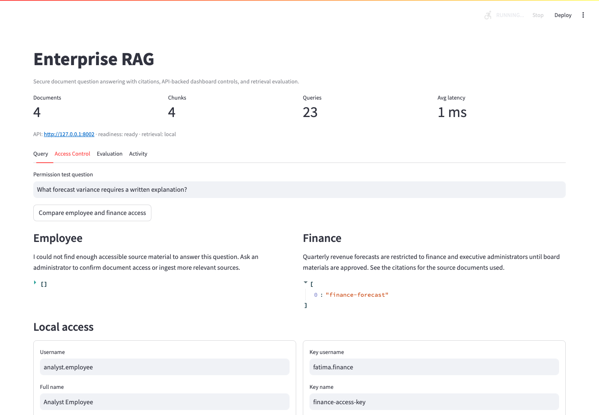
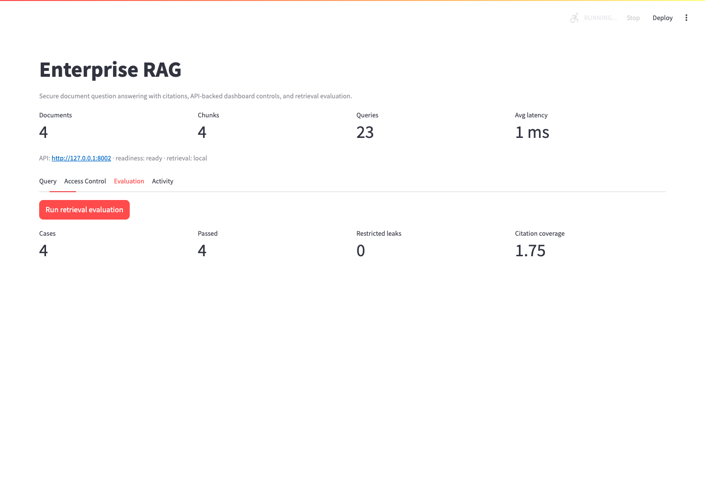

# Enterprise RAG

Enterprise RAG is a local-first secure knowledge search system for internal company documents. It answers questions with citations, filters retrieval by role-based access control, records operational metrics, and includes a retrieval evaluation set that checks citation coverage and restricted document leakage.

## Business Use Case

Companies need employees to find policy, support, finance, and security information quickly without leaking restricted documents. This project implements a production-oriented RAG pattern for internal knowledge bases where source attribution, access control, and measurable retrieval quality are core requirements.

Client persona: IT, operations, security, or enablement teams that need controlled document question answering across internal knowledge sources.

Business value:

- Reduces time spent searching policy and operational documents.
- Reduces risk of unauthorized access to sensitive finance or security information.
- Makes answer quality measurable through retrieval tests, citation coverage, and leakage checks.

## Architecture

```text
Local documents
      |
      v
Ingestion API  --->  Metadata and chunk store
      |
      v
FastAPI query API  <---  Dashboard / API clients
      |
      v
Role-based access filter
      |
      v
Retriever  --->  Answer generator
      |                  |
      v                  v
Citations, metrics, query logs, and evaluation results
```

See [docs/architecture.md](docs/architecture.md) for local and Azure-ready diagrams.

## Local Quick Start

```bash
cd enterprise-rag
python3.12 -m venv .venv
.venv/bin/pip install -r requirements.txt
cp .env.example .env
.venv/bin/python demo/seed_data.py
.venv/bin/uvicorn enterprise_rag.api:app --host 127.0.0.1 --port 8002
```

The default `LLM_PROVIDER=mock` mode is deterministic and runs without provider credentials, which makes local validation repeatable.

Useful API calls:

```bash
curl http://127.0.0.1:8002/health
curl -X POST http://127.0.0.1:8002/ingest
curl -X POST http://127.0.0.1:8002/query \
  -H "Content-Type: application/json" \
  -d '{"question":"What is the triage target for security incidents?","user_role":"engineer"}'
curl -X POST http://127.0.0.1:8002/eval/run
```

Create a local user API key:

```bash
curl -X POST http://127.0.0.1:8002/auth/register \
  -H "Content-Type: application/json" \
  -d '{"username":"fatima.finance","full_name":"Fatima Finance","role":"finance","password":"change-me-local-password"}'

curl -X POST http://127.0.0.1:8002/api-keys \
  -H "Content-Type: application/json" \
  -d '{"username":"fatima.finance","name":"finance-access-key"}'
```

Use the returned key as `X-API-Key`. When a key is supplied, the API uses the key owner role instead of the request body role.

Optional dashboard:

```bash
.venv/bin/streamlit run dashboard/app.py --server.address 127.0.0.1 --server.port 8511
```

## Validation Workflow

1. Ingest reference documents from `demo/documents`.
2. Ask a public HR or support policy question as `employee`.
3. Ask the security incident triage question as `engineer`.
4. Ask the finance forecast variance question as `employee` and verify the restricted finance document is not cited.
5. Create a finance API key, ask the same question with `X-API-Key`, and verify the finance document is cited.
6. Revoke the API key and verify the revoked key is rejected.
7. Run `/eval/run` to show pass rate, citation coverage, latency, and restricted leakage count.

See [demo/README.md](demo/README.md).

## Screenshots

Dashboard overview:


Citation-backed answer:


Permission comparison:



Evaluation summary:



## Environment Variables

The project runs locally with deterministic generation by default. OpenAI, Azure OpenAI, Azure AI Search, Azure PostgreSQL, Key Vault, and Entra settings are activated through environment configuration.

Key variables:

- `RAG_DATABASE_PATH`: SQLite database path.
- `RAG_DOCUMENT_PATH`: local document directory.
- `RAG_EVAL_SET_PATH`: retrieval evaluation JSON file.
- `RAG_RETRIEVAL_PROVIDER`: `local`, `openai`, or `azure_ai_search`; `local` and Azure AI Search keyword retrieval are implemented.
- `LLM_PROVIDER`: `mock`, `openai`, or `azure`.
- `CORS_ORIGINS`: comma-separated browser origins allowed to call the API.
- `SECURITY_HEADERS_ENABLED`: enables default HTTP security headers.
- `JSON_LOGS`: emits structured JSON request logs when true.
- `ADMIN_TOKEN`: optional management token for ingestion, user/key management, audit logs, and evaluation runs.
- `RATE_LIMIT_PER_MINUTE`: in-memory per-client request limit for local and single-instance deployments.
- `DASHBOARD_API_URL`: FastAPI URL used by the Streamlit dashboard.
- `DASHBOARD_ADMIN_TOKEN`: admin token forwarded by the dashboard when management protection is enabled.
- `STORAGE_BACKEND`: `sqlite`, `postgres`, or `azure_postgres`.
- `DATABASE_URL`: PostgreSQL connection string for `postgres` or `azure_postgres` storage.
- `AUTH_PROVIDER`: `local`, `oidc`, or `entra`.
- `OPENAI_API_KEY`: required only for OpenAI mode.
- `AZURE_OPENAI_*`, `AZURE_AI_SEARCH_*`, `AZURE_BLOB_*`: required only for Azure mode.
- `KEY_VAULT_SECRET_NAMES`: optional comma-separated Azure Key Vault secret names to load at startup.
- `KEY_VAULT_SECRET_MAPPINGS`: optional mappings such as `OPENAI-API-KEY=OPENAI_API_KEY,DATABASE-URL=DATABASE_URL`.

## Metrics And Evaluation

Implemented metrics:

- document and chunk count
- query count
- average query latency
- Prometheus-style operational metrics
- retrieved chunk count
- RBAC-blocked chunk count
- citation count and top retrieval score
- evaluation pass rate
- restricted leakage count
- citation coverage

## Security Notes

Retrieval applies access control before scoring, so unauthorized chunks are excluded from the candidate set. Reference metadata uses role lists such as `all`, `engineer`, `finance`, and `admin`. Production deployments can derive role context from Entra ID or another OIDC identity provider.

Local API keys are random tokens. Only SHA-256 key hashes are stored, and revoked keys are rejected by the query endpoint.

## Azure Deployment Notes

The architecture supports local operation and Azure-backed deployment:

- SQLite metadata to PostgreSQL or Azure Database for PostgreSQL.
- Local markdown files can move to Azure Blob Storage.
- Local lexical retrieval can move to Azure AI Search.
- Deterministic local generation can move to Azure OpenAI.
- Local dashboard/API hosting to Azure Container Apps.
- Local logs to Application Insights.

See [docs/deployment.md](docs/deployment.md).

## Implementation Summary

This implementation provides a credential-free local runtime with ingestion, citation-backed answers, role-aware retrieval, OpenAI/Azure OpenAI generation adapters, Azure AI Search retrieval adapter, PostgreSQL-compatible managed storage, evaluation, API endpoints, an API-backed Streamlit dashboard, tests, Docker files, operational controls, and production-focused documentation.

Public release validation:

```bash
.venv/bin/python scripts/prepare_public_release.py --destination ../enterprise-rag-public
```

External integration verification:

```bash
.venv/bin/python scripts/verify_live_integrations.py
```
