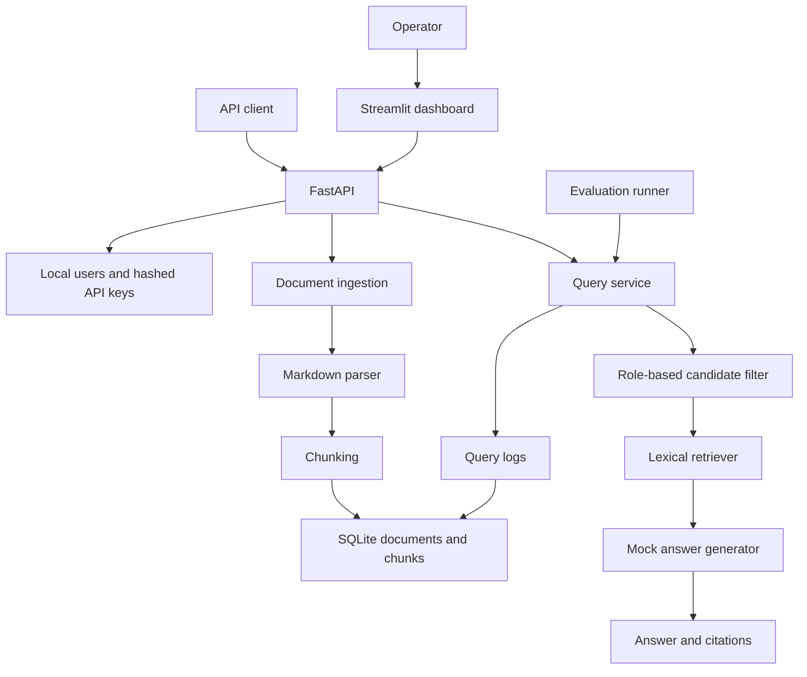
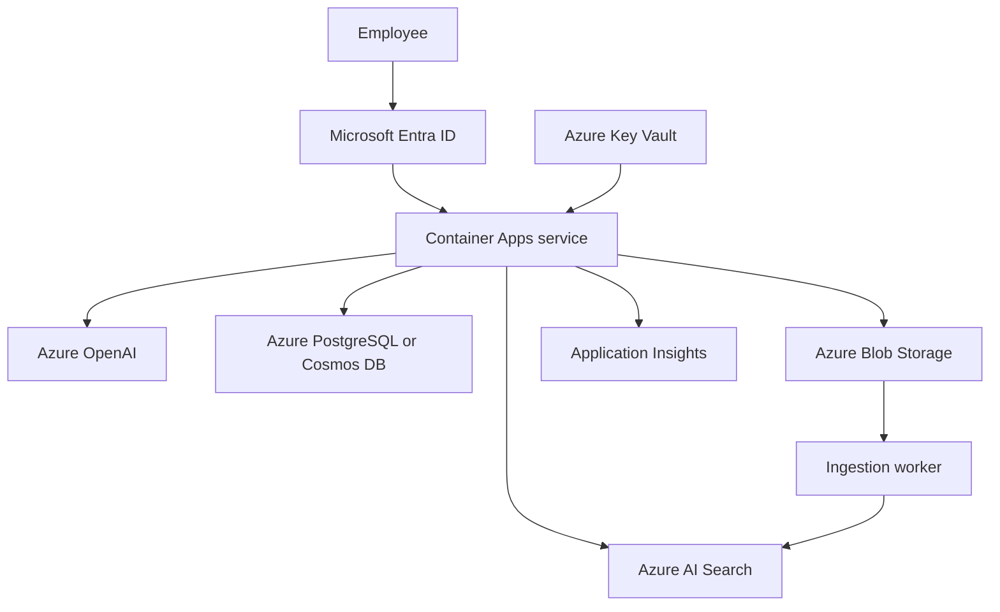
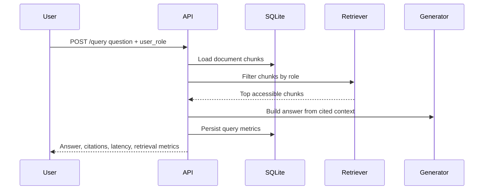

# Architecture

## Local Architecture

The local architecture intentionally avoids cloud dependencies. Documents are markdown files with metadata front matter, SQLite stores metadata and chunks, and deterministic retrieval keeps validation reproducible. The dashboard is API-backed and does not read the database directly, so the same UI boundary can be retained for container or Azure deployment.

## Azure-Ready Architecture

Cloud services are activated by environment configuration. Local mode remains the default runtime, while Azure OpenAI, Azure AI Search, Azure PostgreSQL, Key Vault, and Entra ID can be enabled for managed deployments.

## Request Flow

